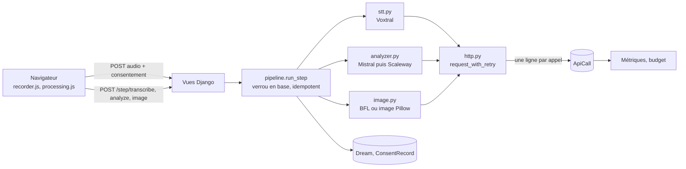

# Synthétiseur de rêves

Racontez un rêve à voix haute : l'application le transcrit (Voxtral), en
reconnaît l'émotion et en tire un prompt d'image (Mistral Small), génère une
image (FLUX, Black Forest Labs) et range le tout dans un journal personnel,
avec historique filtrable et tableau de bord. Toute la chaîne IA repose sur
des sous-traitants européens, et toute panne d'API bascule sur un mode de
secours ou simulé, signalé à l'écran : l'application ne renvoie jamais
d'erreur 500.

Projet individuel RNCP 36146 (Concepteur développeur de solutions digitales).
Les choix techniques sont justifiés dans [docs/DECISIONS.md](docs/DECISIONS.md)
(D1 à D37) et les tickets décrits dans [docs/backlog.md](docs/backlog.md).

## Sommaire

1. [Fonctionnalités](#fonctionnalités)
2. [Architecture](#architecture)
3. [Installation](#installation)
4. [Configuration](#configuration)
5. [Coûts et budget](#coûts-et-budget)
6. [RGPD et éthique](#rgpd-et-éthique)
7. [Tests et qualité](#tests-et-qualité)
8. [Performances](#performances)
9. [Déploiement](#déploiement)
10. [Exploitation](#exploitation)
11. [Structure du dépôt](#structure-du-dépôt)

## Fonctionnalités

| Écran | Rôle |
|---|---|
| Nouveau rêve | Consentement explicite, enregistrement au micro (5 min au plus) ou import WAV/MP3 |
| Traitement | Transcription, émotion puis image, chacune affichée dès qu'elle est prête, avec un badge réel / secours / simulé |
| Mes rêves | Historique paginé, filtres par période et par émotion |
| Page d'un rêve | Transcription, émotion, thèmes, résumé, image (« Image générée par IA »), suppression |
| Tableau de bord | Rêves par semaine, répartition des émotions, émotion dominante sur 30 jours, intensité moyenne |
| Mon espace | Accès aux pages ci-dessus, suppression du compte |
| Métriques (staff) | Latences p50/p95, taux de mode dégradé, coûts, budget du mois |
| `/health` | État de la base et des fournisseurs, sans secret |

L'émotion affichée est une indication, pas un diagnostic : l'interface le
dit sur la page d'un rêve, la page « Traitement » et le tableau de bord.

## Architecture

Diagrammes détaillés dans [docs/diagrams/](docs/diagrams/) (Mermaid) :
contexte C4 (`c4_context.mmd`), conteneurs C4 (`c4_container.mmd`), modèle
de données (`erd.mmd`) et séquence du traitement d'un rêve (`sequence.mmd`).



- **Django 5.2**, rendu serveur (Tailwind et Chart.js par CDN, versions
  figées), trois petits scripts JavaScript sans build.
- **Trois étapes appelées l'une après l'autre** par la page « Traitement ».
  Chacune est idempotente côté serveur : un verrou est posé par un `UPDATE`
  conditionnel avant tout appel payant. Un double clic ou un second onglet ne
  paie donc jamais deux fois (D24).
- **Un seul client HTTP** (`dreams/services/http.py`) : 3 tentatives, délais
  de 1 puis 3 s, `Retry-After` respecté jusqu'à 10 s, budget total de 100 s,
  et une ligne `ApiCall` par appel logique, coût compris (D13, D14, D22).
- **Chaîne de secours** : Voxtral → transcription simulée ; Mistral Small →
  Scaleway → analyse simulée ; BFL → image de remplacement Pillow. La
  provenance est enregistrée et affichée (D17 à D20, D23).
- **Données** : PostgreSQL en production et en CI, SQLite en développement.
  L'audio et l'image sont stockés en base (`BinaryField`) : l'audio est
  effacé dès la transcription, l'image n'est servie qu'à son propriétaire.

Modèles retenus (versions datées, D28) : `voxtral-mini-2602`,
`mistral-small-2603`, secours `mistral-small-3.2-24b-instruct-2506`
(Scaleway), `flux-3-image-klein` sur l'endpoint UE de BFL.

## Installation

Prérequis : Python 3.12 (mode venv) ou Docker avec Compose v2 (mode
Docker). Sans aucune clé d'API, tout fonctionne en mode simulé.

```bash
./install.sh docker   # application + PostgreSQL 16 -> http://localhost:8000
./install.sh venv     # environnement virtuel + SQLite, puis :
.venv/bin/python manage.py runserver   # Windows : .venv/Scripts/python.exe
```

`install.sh` crée `.env` à partir de `.env.example` sans jamais écraser un
fichier existant, et génère une `DJANGO_SECRET_KEY` si elle est vide.

Installation manuelle, si besoin :

```bash
# Docker
cp .env.example .env
docker compose up --build

# Environnement virtuel
python -m venv .venv
source .venv/bin/activate          # Windows : .venv\Scripts\activate
pip install -r requirements-dev.txt
cp .env.example .env               # DJANGO_DEBUG=True suffit en local
python manage.py migrate
python manage.py runserver
```

Créer un compte d'administration (accès à l'admin et à la page Métriques) :
`python manage.py createsuperuser`, ou dans Docker
`docker compose exec web python manage.py createsuperuser`.

Pour obtenir des résultats réels, renseigner `MISTRAL_API_KEY` (transcription
et analyse) et `BFL_API_KEY` avec `IMAGE_PROVIDER=bfl` (image) dans `.env`.

## Configuration

Toutes les valeurs viennent de l'environnement (fichier `.env` en local,
variables du service sur Render). [`.env.example`](.env.example) les liste
toutes, avec leur rôle. Les principales :

| Variable | Défaut | Rôle |
|---|---|---|
| `DJANGO_SECRET_KEY` | — | Obligatoire hors DEBUG : l'application refuse de démarrer sans |
| `DJANGO_DEBUG` | `False` | `True` en développement |
| `DATABASE_URL` | SQLite | PostgreSQL en production |
| `ADMIN_URL` | `admin` | Chemin de l'admin |
| `MISTRAL_API_KEY`, `SCALEWAY_API_KEY`, `BFL_API_KEY` | vides | Sans clé : mode simulé pour l'étape |
| `IMAGE_PROVIDER` | `mock` | `mock` ou `bfl` ; une valeur inconnue est signalée au démarrage et dans `/health` |
| `MONTHLY_BUDGET_USD` | `20` | Plafond mensuel global |
| `EUR_TO_USD_RATE` | `1.21` | Conversion des tarifs facturés en euros |
| `DREAM_RETENTION_DAYS` | `365` | Conservation des rêves |
| `ORPHAN_AUDIO_MAX_AGE_MINUTES` | `60` | Effacement d'un audio jamais transcrit |
| `SENTRY_DSN` | vide | Sentry activé seulement s'il est défini |

## Coûts et budget

Tarifs relevés sur la facture du test réel du 10 novembre 2026 (D28) :
Voxtral 0,0000425 € par seconde d'audio, Mistral Small 0,13 € / 0,51 € par
million de tokens (entrée / sortie), FLUX 3 Image Klein 0,009 $ l'image. Les
euros sont convertis à 1,21 $/€, un taux volontairement haut.

| Poste, pour un récit de 2 minutes | Coût |
|---|---|
| Transcription (120 s) | 0,0062 $ |
| Analyse (1 000 tokens en entrée, 300 en sortie) | 0,0003 $ |
| Image | 0,0090 $ |
| **Total par rêve** | **0,0155 $** (cible du cadrage : < 0,03 $) |
| 10 rêves par jour pendant 30 jours | 4,65 $ |

Chaque appel enregistre son coût réel dans `ApiCall`. Le budget du mois
(`MONTHLY_BUDGET_USD`) cumule tous les appels du mois civil, en heure de
Paris. Une fois le plafond atteint, les nouveaux rêves sont refusés
proprement jusqu'au 1er du mois suivant (D32). L'image représente près de
60 % du coût d'un rêve.

## RGPD et éthique

Un récit de rêve peut révéler la santé ou la vie intime d'une personne : il
est traité comme une donnée sensible (article 9).

- **Consentement explicite**, case non pré-cochée, enregistré en base avec
  la version du texte, la date et l'IP, et **vérifié côté serveur avant
  chaque étape** : un appel direct sans consentement reçoit 403 (D24).
- **Minimisation** : l'audio est effacé dès la transcription ; un audio
  jamais transcrit l'est après une heure. BFL ne reçoit qu'un prompt en
  anglais rédigé par le LLM, jamais la transcription. Pas d'adresse e-mail
  à l'inscription (D7).
- **Droits** : suppression réelle d'un rêve (image comprise) ou du compte
  (rêves, consentements et journal des appels ; le coût du mois est reporté
  sans lien avec la personne pour que le budget reste exact, D34). Les
  rêves sont purgés après 365 jours (`manage.py purge_dreams`).
- **Isolation** : le rêve ou l'image d'un autre utilisateur renvoie 404 ;
  l'admin est en lecture seule et n'affiche aucun contenu de rêve (D11).
- **Sous-traitants dans l'UE** : Mistral AI (France), Black Forest Labs
  (endpoint UE), Scaleway (France) en secours, Render en région Francfort.
  Sentry, s'il est activé, ne reçoit ni données personnelles, ni corps de
  requête, ni variables locales (D33).
- **IA Act** : l'émotion est déduite du texte, pas de la voix ni du visage
  (pas de reconnaissance biométrique des émotions). Chaque image réelle
  porte la mention « Image générée par IA » ; l'image de remplacement, faite
  sans IA, l'indique aussi (D30).

Prérequis avant un lancement public, hors périmètre du projet : analyse
d'impact (AIPD), DPA avec chaque sous-traitant, vérification de la clause de
non-entraînement de Black Forest Labs.

## Tests et qualité

```bash
ruff check . && ruff format --check .
pytest --cov=dreams --cov=accounts --cov-fail-under=70
```

- Environ 300 tests, quelques secondes en local ; couverture de `dreams` et
  `accounts` d'environ 99 % (seuil bloquant de 70 % en CI).
- Aucun test n'appelle une API réelle ni n'attend vraiment : le réseau passe
  par un faux serveur `httpx.MockTransport` qui fait échouer toute requête
  imprévue, et les délais sont enregistrés au lieu d'être attendus (D15).
  Les tests ne lisent pas le `.env` local (D28).
- Pannes simulées (500, 429, timeout, JSON invalide), chaîne de secours,
  idempotence, consentement, isolation entre utilisateurs, RGPD, budget,
  statistiques, métriques.
- **CI GitHub Actions** sur chaque PR : ruff, pytest sur PostgreSQL 16 avec
  vérification des migrations, build Docker et test de fumée sur `/health`,
  puis déploiement sur `main`.

## Performances

Mesures réelles du 2026-11-10 ([docs/latences.csv](docs/latences.csv),
`scripts/bench_latency.py`, 10 appels par API, récit parlé de 122 s) :

| API | Médiane | p95 |
|---|---|---|
| Transcription Voxtral (122 s d'audio) | 4,0 s | 5,4 s |
| Analyse Mistral Small | 1,9 s | 2,1 s |
| Image BFL, au total | 38,2 s | 57,4 s |
| dont soumission / attente / téléchargement | 0,8 / 36,6 / 0,7 s | 1,0 / 55,9 / 0,9 s |

La transcription et l'émotion s'affichent environ 6 s après le dépôt ;
l'image arrive ensuite. Presque tout le temps de bout en bout est l'attente
de l'image chez BFL (statut `Generating`), très variable : de 22 à 58 s sur
10 essais. La cible du cadrage (médiane < 30 s, p95 < 45 s) n'est donc pas
tenue à cause de l'image (D37).

Test de charge en mode simulé, 10 puis 25 rêves simultanés
([docs/charge.md](docs/charge.md), `tests/load/load_test.py`) : aucune
erreur 500. Sans limite de CPU, la cible de 2 s par requête est tenue à 10
rêves et dépassée de peu à 25. À 0,5 CPU (offre Starter de Render), elle
l'est presque à 10 et pas à 25. À 0,1 CPU (offre gratuite), elle ne l'est
plus du tout.

```bash
# Le serveur doit tourner en mode simulé (le script vérifie /health).
python tests/load/load_test.py --base-url http://localhost:8000 --users 10 25
# Clés réelles dans .env ; une API sans clé n'est jamais appelée.
python scripts/bench_latency.py --audio recit.wav --runs 10
```

## Déploiement

[`render.yaml`](render.yaml) décrit un service web Docker et une base
PostgreSQL 16, tous deux en **région Francfort** (D35).

1. Sur Render : *New* → *Blueprint* sur ce dépôt, puis saisir les variables
   marquées `sync: false` (`MISTRAL_API_KEY`, `BFL_API_KEY`, `ADMIN_URL`, et
   si besoin `SCALEWAY_API_KEY` et `SENTRY_DSN`).
2. Copier le *Deploy Hook* du service dans le secret GitHub
   `RENDER_DEPLOY_HOOK`.
3. Chaque fusion sur `main` lance la CI ; après lint, tests et build, le
   job `deploy` appelle le hook. Il n'y a pas de déploiement automatique sans
   tests verts.

Au démarrage, le conteneur applique les migrations, lance la purge RGPD,
puis Gunicorn (2 processus × 4 threads, utilisateur non-root). Avant une
démo, appeler `/health` pour réveiller l'instance gratuite.

## Exploitation

- **`/health`** : état de la base, fournisseur d'images (avertissement si
  `IMAGE_PROVIDER` est inconnu ou si la clé manque) et présence des clés.
  Répond 503 seulement si la base est injoignable.
- **`/metriques/`** (staff) : latences p50/p95 par étape et de bout en
  bout, taux de mode dégradé, appels en erreur, coût moyen par rêve et
  budget du mois.
- **Logs** : une ligne `clé=valeur` par événement sur la sortie standard
  (`event=api_call` avec coût et latence, `bfl_timing`, `budget_exceeded`,
  `purge`…). Les clés d'API et le contenu des rêves n'y figurent jamais.
- **Purge** : `python manage.py purge_dreams [--dry-run]`.

## Structure du dépôt

```text
config/            réglages (environnement), URL, /health, Sentry
accounts/          inscription, espace personnel, suppression du compte
dreams/
  models.py        Dream, ConsentRecord, ApiCall, UsageCarryover
  views.py         dépôt, traitement, historique, tableau de bord, métriques
  services/        http (retry), stt, analyzer, image, pipeline, costs,
                   budget, stats, metrics, retention, consent, audio, mock
  management/      commande purge_dreams
templates/, static/js/   pages et scripts (enregistreur, traitement, graphiques)
tests/             suite pytest ; tests/load/ : test de charge
scripts/           bench_latency.py (latences réelles)
docs/              DECISIONS.md, backlog.md, charge.md, latences.csv,
                   diagrams/ (C4, modèle de données, séquence)
Dockerfile, docker-compose.yml, render.yaml, install.sh
```
